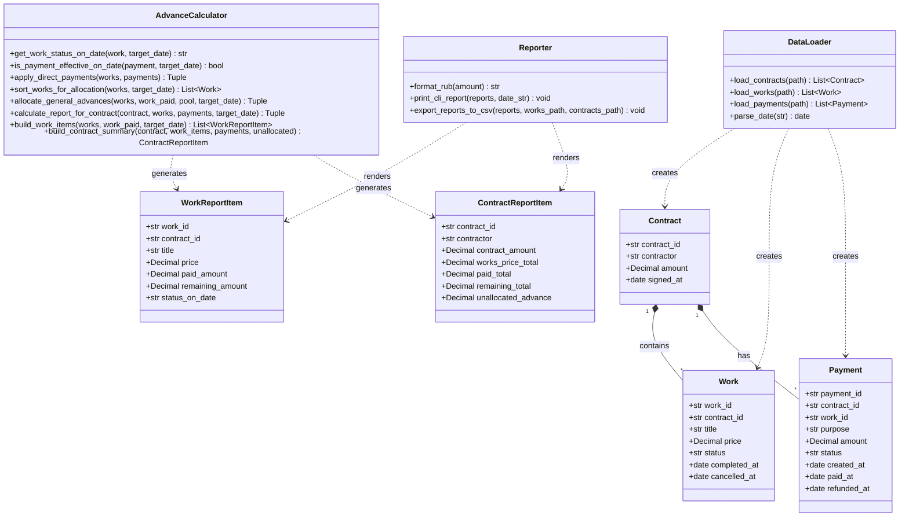
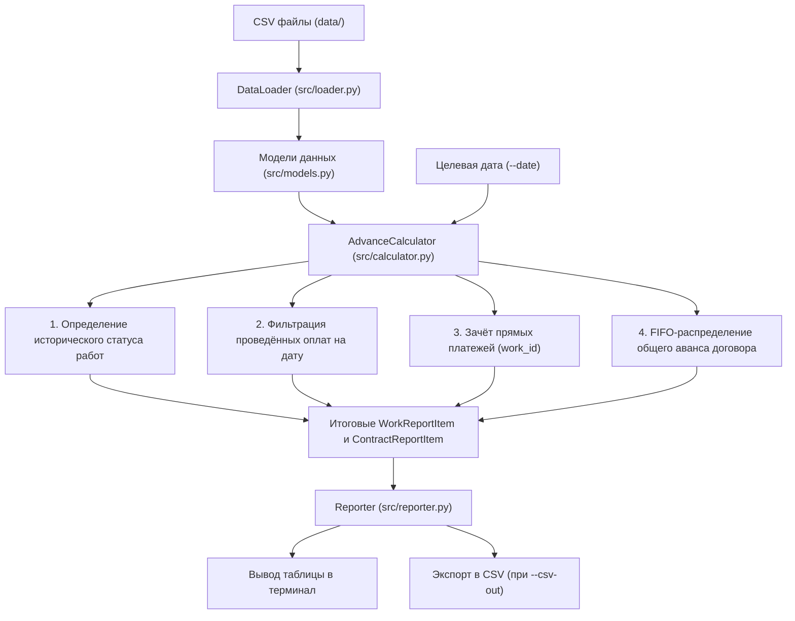

# Архитектура проекта и UML-диаграмма

## Описание системы
Программа строит отчёт по взаиморасчётам с подрядчиками на заданную дату. Модули разделены по принципу единой ответственности (SRP) и используют строгую типизацию (`Decimal`, `dataclass`).

## Пайплайн обработки данных

